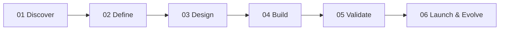

### Building AI-Powered Products That People Love.

**AI-Powered Product Design & Development Agency**

Design-led thinking. Engineering excellence. AI-enabled innovation.

 

---

## ✦ Who We Are

**DesignJanala** is a product design and development agency based in Dhaka, Bangladesh.

We partner with startups, founders, and businesses to transform ambitious ideas into intuitive digital experiences and scalable software.

From product strategy and UI/UX design to engineering, AI integration, and quality assurance, we bring the complete product journey together.

> Great technology should feel simple to use, reliable to run, and ready to grow.

## ✦ What We Do

<table>
<tr>
<td width="50%" valign="top">

### ◈ Product & Web Engineering

- SaaS platforms
- Web applications
- Custom software
- Backend engineering
- API development

</td>
<td width="50%" valign="top">

### ◈ AI & Automation

- AI agents
- LLM integrations
- RAG solutions
- Intelligent automation
- AI-powered applications

</td>
</tr>
<tr>
<td width="50%" valign="top">

### ◈ Product Design

- UI/UX design
- Product strategy
- Design systems
- Prototyping
- Brand identity

</td>
<td width="50%" valign="top">

### ◈ Quality & Growth

- MVP development
- Manual & automated QA
- Performance optimization
- Product modernization
- Technical support

</td>
</tr>
</table>

## ✦ Technology Ecosystem

**Frontend & Experience**

**Backend & CMS**

**Database & Infrastructure**

**Design & Collaboration**

## ✦ AI-Enhanced Engineering

AI is part of our workflow across discovery, design, development, and testing.

- AI-assisted research and requirement analysis
- Rapid concept exploration and prototyping
- AI-assisted development with human code review
- LLM-powered product features
- Automated testing and quality engineering
- Intelligent business workflow automation

## ✦ Our Development Process

| Phase | Objective |
|---|---|
| Discover | Understand users and business goals |
| Define | Establish scope and architecture |
| Design | Create intuitive experiences |
| Build | Develop production-ready products |
| Validate | Test functionality and quality |
| Evolve | Launch, monitor, and improve |

## ✦ Industries We Serve

- SaaS & Startups
- Fintech
- Healthcare
- E-commerce
- Real Estate
- Education
- Logistics
- Media & Publishing

## ✦ Our Principles

- **Product First** — Solve real-world problems.
- **Design Excellence** — Create meaningful experiences.
- **Engineering Quality** — Build reliable and maintainable systems.
- **AI Innovation** — Use AI to accelerate product development.
- **Scalability** — Build for long-term growth.
- **Collaboration** — Grow through transparency and teamwork.

---

## Have an Idea Worth Building?

Let's turn your vision into a powerful digital product.

**DesignJanala** · Dhaka, Bangladesh

*From Ideas to Products. Powered by Design, Engineering & AI.*

